# Tenstorrent Blackhole Documentation & Architecture Knowledge Base

Welcome to the native Rust software stack documentation for Tenstorrent Blackhole (p100/p150a/p300).

Documentation in this repository is organized into a **3-tier lifecycle structure** (finished plans are then archived in `docs/completed-plans/`) to separate permanent empirical knowledge from active implementation plans and unscheduled feature proposals:

```mermaid
flowchart TD
    subgraph Tier3["Tier 3: docs/proposals/ (RFCs & Design Notes)"]
        P1["x280-on-card-dispatch.md<br/><i>(Proposed, unscheduled)</i>"]
        P2["future-fusion-features.md<br/><i>(FlashAttention, Sharded L1, NoC stream)</i>"]
        P3["batched-decode.md<br/><i>(tile-row batches, paged position-major cache)</i>"]
        P4["sram-residency-and-multi-card-decode.md<br/><i>(L1 weights rejected, exact 2-card TP)</i>"]
    end

    subgraph Tier2["Tier 2: docs/plans/ (Active Specs)"]
        PL0["roadmap.md (START HERE: open work only)"]
        PL3["new-op-definition-of-done.md (standing contract for new ops)<br>conformance-to-feature.md (standing process: failing Burn test to documented feature)"]
        PL4["burn-op-coverage.md (generated) + burn-op-notes.md"]
        PL5["burn-backend-parity.md (B0-B16 Roadmap)"]
        PL6["burn-native-cutover.md (Native Cutover Record)"]
        PL7["traced-execution.md (Unified Inference & Training)"]
        PL8["kernel-fusion.md (B12 & B13a-c Burn Fusion)"]
        PL9["mixed-bfp-storage.md (BFP8/4/2 Contract & PRNG Diagnostics)"]
        PL10["ttinsn-push-experiment.md (done: result go)"]
        PL11["decode-to-bandwidth.md, decode-attention.md, decode-matmul-bandwidth.md, decode-small-ops.md, in-place-cache-write.md (LLM decode performance)"]
        PL12["ttinsn-push.md (fused push from the host, the default)"]
    end

    subgraph Tier1["Tier 1: docs/learnings/ (Ground Truth & Learnings)"]
        L1["silicon-operating-notes.md (Hardware Traps, Fences, Boot)"]
        L2["ttsim-divergence.md (Rows 1..N, Simulator Quirks)"]
        L3["performance-scoreboard.md (current numbers)<br>performance-log.md (run history)"]
        L4["riscv-guide-review.md (Baby RISC-V Facts vs Myths)"]
        L5["tt-metal-concepts-review.md (G1-G16 System Concepts)"]
        L6["streaming-dataflow-architecture.md (Reader/Writer Contract)"]
        L7["kernel-fusion-architecture.md (Two-Stage Fusion & Dst/L1)"]
        L8["tt-metal-comparison.md (+ method): where we stand against tt-metal, fixes to investigate"]
        L9["dataflow-compiler.md (Design Principles below Burn, ADRs 0003-0005)"]
    end

    subgraph Done["docs/completed-plans/ (archive)"]
        D1["phases-0-10-roadmap.md<br>phases-0-10-checklist.md<br>hardware-coverage.md<br>tensix-next-features.md<br>hardware-coverage-closeout.md, ...<br><i>(closed trackers, kept as a record)</i>"]
    end

    Tier3 --"Approval & Scheduling"--> Tier2
    Tier2 --"Empirical Findings & Benchmarks"--> Tier1
    Tier2 --"Graduation of Core Architecture"--> Tier1
    Tier2 --"Closed checklists"--> Done
```

---

**Decisions that bind future work** are recorded beside the tiers as Architectural Decision Records in
[`docs/adr/`](adr/), one numbered file each, with the code paths they govern. Record one with
`scryer record-adr` (which also indexes it, so `query_adrs` and `inspect_symbol` surface it on those paths), and
search them with `scryer query-adrs`. So far:
[0001](adr/0001-llm-support-is-generic-across-architectures-not-model-specific.md), LLM support is generic across
architectures; [0002](adr/0002-profiling-is-one-switchable-mode-and-costs-nothing-unless-built-in.md), profiling is
one switchable mode and costs nothing unless built in; [0003](adr/0003-a-tile-level-dataflow-compiler-below-burn.md), a tile-level dataflow compiler below Burn; [0004](adr/0004-formats-are-edge-data-converted-only-at-unpack-and-pack.md), formats are edge data converted only at unpack and pack; [0005](adr/0005-every-op-has-a-numeric-contract-schedules-choose-only-among-bit-equivalent-options.md), every op has a numeric contract and schedules choose only among bit-equivalent options.

## The Three Tiers

### 1. `docs/learnings/` — Living Background & Empirical Source of Truth
Permanent, cumulative empirical realities discovered through silicon execution, hardware timing, and simulator testing.
- **Contract**: **Must be kept continuously up to date**. When new hardware behaviors, simulator divergences, or benchmark baselines are measured, record them here immediately.
- **Contents**:
  - [`silicon-operating-notes.md`](learnings/silicon-operating-notes.md): Critical hardware rules (ARC tile coordinate invariance, popcount harvesting, local RAM reset hazards, host crash prevention, power policy).
  - [`ttsim-divergence.md`](learnings/ttsim-divergence.md): Numbered catalog of every discrepancy between `ttsim`, the ISA spec, and real silicon.
  - [`performance-scoreboard.md`](learnings/performance-scoreboard.md): Current performance rows, how to measure, and the stated bottlenecks. Update rows in place.
  - [`performance-log.md`](learnings/performance-log.md): Run history and evidence: cycle counts, instruction latencies, DRAM bandwidth saturation, icache measurements, change log.
  - [`riscv-guide-review.md`](learnings/riscv-guide-review.md): Measured facts vs external misconceptions regarding baby RISC-V cores, caches, and memory maps.
  - [`tt-metal-concepts-review.md`](learnings/tt-metal-concepts-review.md): Architectural comparison of tt-metal concepts (G1–G16) vs this native Rust stack.
  - [`tt-metal-comparison.md`](learnings/tt-metal-comparison.md): Dated snapshot (2026-10-26) of the project's state and of every performance result and limit against tt-metal's own LLM stack (traces, dispatch cost, attention, SFPU, multi-chip, DRAM), with fixes to investigate (F1-F27). Re-run it with [`tt-metal-comparison-method.md`](learnings/tt-metal-comparison-method.md): the procedure, claims sheet and agent prompts.
  - [`streaming-dataflow-architecture.md`](learnings/streaming-dataflow-architecture.md): The core architectural contract of the GDDR streaming scheduler (B reader on NoC0, T0–T2 compute, NC writer on NoC1, streaming credits, transfer channels).
  - [`dataflow-compiler.md`](learnings/dataflow-compiler.md): **The design principles every optimization below Burn builds on** (ADRs 0003-0005): the machine's fundamental truths, Kahn semantics and per-op numeric contracts, formats as edge data, the tile-generic op and dataflow-graph IR, transforms written once with their legality, credits and deadlock checks, the cost model, decisions between Tenstorrent's designs and alternatives, and a hypotheses register. Every principle carries its evidence.
  - [`kernel-fusion-architecture.md`](learnings/kernel-fusion-architecture.md): Architectural ground truth on two-stage kernel fusion (Burn IR vs. Tensix hardware), Dst register allocation, and L1 Circular Buffer streaming. Its §4 (no second graph compiler) and §6.2 are superseded by `dataflow-compiler.md`.

### 2. `docs/plans/` — Active Implementation Plans
Actionable technical specifications, interface contracts, and execution checklists (`[ ]` / `[x]`) for active and long-running engineering milestones.
- **Contract**: Checked off as gates pass on simulator and silicon. Contains all information required to implement and verify features.
- **Start with [`roadmap.md`](plans/roadmap.md)**: the single list of open work (first real models, performance, multi-chip, long-term publishing). The other plans are the evidence and detail behind it.
- **Contents**:
  - [`roadmap.md`](plans/roadmap.md): Open work only, grouped into tracks, each item linking to its detailed plan and evidence.
  - [`burn-op-coverage.md`](plans/burn-op-coverage.md): Generated (`cargo xtask burn-coverage`) status of every Burn operation-trait method: native, composed or explicitly unsupported with its `[-]` reason.
  - [`new-op-definition-of-done.md`](plans/new-op-definition-of-done.md): The standing contract every new kernel/op must meet (oracle, simulator gate with negative control, silicon on one card, Burn routing, padding, findings logged).
  - [`burn-op-notes.md`](plans/burn-op-notes.md): Hand-written per-method Device and Item notes behind the generated Burn op table.
  - [`ttinsn-push-experiment.md`](plans/ttinsn-push-experiment.md): Done (2026-10-10): `.ttinsn` push fusion measured 2.77x on a push-bound SFPU kernel on card 0; its follow-on is `ttinsn-push.md`.
  - [`ttinsn-push.md`](plans/ttinsn-push.md): fused `.ttinsn` push from the host (2026-10-25): the math role's long programs as host-made, host-validated code in the program cache, on by default; the profile mode's push totals; one item left (the experiment image no longer fits T1's slot).
  - [`burn-backend-parity.md`](plans/burn-backend-parity.md): B0–B16 roadmap for `burn-tt` to achieve full backend parity with CubeCL/CUDA.
  - [`burn-native-cutover.md`](plans/burn-native-cutover.md): Native cutover record, retired Flex fallback, delivered tensor storage and deferred formats.
  - [`mixed-bfp-storage.md`](plans/mixed-bfp-storage.md): Delivered BFP8/4/2 storage and training contract, acceptance checklist, PRNG diagnostics and remaining application RNG work.
  - [`traced-execution.md`](plans/traced-execution.md): Comprehensive implementation plan for generalized multi-input inference and whole training step hardware traces (`TracedInference`, `TracedTrainingStep`).
  - [`kernel-fusion.md`](plans/kernel-fusion.md): Actionable specification and execution checklist for Burn backend kernel fusion milestones B12 and B13a–B13c.
  - [`dataflow-compiler.md`](plans/dataflow-compiler.md): the staged dataflow compiler (2026-10-28): card-1 baselines, `TileFormat` and one matmul for every format pair, typed channels with cross-core credits, the tile-generic op, operand reuse (compute) and channels instead of barriers (decode), `Dst` subblocks, then fusion and spatial pipelining; each stage a hypothesis with a kill criterion.
  - [`decode-matmul-bandwidth.md`](plans/decode-matmul-bandwidth.md): an LLM decode step's `m = 1` products against GDDR's bandwidth (P0-P3 done: thin activation reads, an even last round, fused projections; P5 open: one channel a column).
  - [`decode-to-bandwidth.md`](plans/decode-to-bandwidth.md): the umbrella plan for single-user decode at 90-95% of GDDR's bandwidth, ordering the decode plans below; with [`decode-attention.md`](plans/decode-attention.md) (attention reading the cache in place).
  - [`decode-small-ops.md`](plans/decode-small-ops.md): the decode step's non-matmul half (RMSNorm, RoPE, attention, SiLU): repack fixes first, then where fusion lives.
  - [`long-context.md`](plans/long-context.md): real model context lengths (8K on the 1.7B, 32K synthetic): traces whose programs do not grow with length, prefill that costs the prompt not the cache, and flash-decode past the fused attention op's L1 limit.
  - [`in-place-cache-write.md`](plans/in-place-cache-write.md): writing a traced key/value cache in place (no whole-cache copy a write), and the donation and buffer-generation rules that make a read of the overwritten cache an error by name (was a proposal).

### 3. `docs/proposals/` — Feature Proposals & RFCs
Unscheduled design proposals and exploratory RFCs evaluating trade-offs before implementation.
- **Contract**: When approved and scheduled, a proposal graduates into an implementation plan in `docs/plans/` (or is incorporated into an existing plan) and is removed from proposals.
- **Contents**:
  - [`x280-on-card-dispatch.md`](proposals/x280-on-card-dispatch.md): RFC proposing use of on-card SiFive X280 RISC-V cores for on-card host orchestration.
  - [`future-fusion-features.md`](proposals/future-fusion-features.md): RFCs for advanced fusion: Tiled Online Softmax FlashAttention, sharded multi-core L1 mesh tensor residency, and inter-core NoC streaming.
  - [`split-k-and-flash-decode.md`](proposals/split-k-and-flash-decode.md): the two order-changing decode levers, for a decision: flash-decode (attention's positions split across units; ~0.8-1.1 ms of a 1.7B step at 512 positions, recommended opt-in as variant A) and split-K (~0.2 ms by the handoff's measurement, parked).
  - [`batched-decode.md`](proposals/batched-decode.md): batched decode laid out on Blackhole's tiles (sequences as the rows of a tile row, batches of 8/16/32, a paged position-major cache, per-sequence attention items, on-card sampling); unscheduled behind batch-1 speed.
  - [`sram-residency-and-multi-card-decode.md`](proposals/sram-residency-and-multi-card-decode.md): Cerebras' weight-resident wafer pipeline against Blackhole. Weights resident in L1 are rejected with the arithmetic. Exact tensor parallelism across two cards (`N`-split products, all-gather, bit for bit) is a candidate batch-1 lever, gated on measuring an Ethernet hop. Pipelined micro-batches are noted for batched decode.

### Completed plans: `docs/completed-plans/`
Plans whose checklists are closed move here as a record, with their evidence. They are not updated; current behaviour lives in `docs/learnings/` and the active plans, and any item still open is carried in [`roadmap.md`](plans/roadmap.md).
- [`phases-0-10-roadmap.md`](completed-plans/phases-0-10-roadmap.md): architecture and phase rationale for Phases 0-10.
- [`phases-0-10-checklist.md`](completed-plans/phases-0-10-checklist.md): the Phase 0-10 tick-list and evidence.
- [`hardware-coverage.md`](completed-plans/hardware-coverage.md): the Phase 10 tracker (instruction inventory, items X/P/F/S/M/R/D, hazards). Source comments cite its item ids.
- [`hardware-coverage-closeout.md`](completed-plans/hardware-coverage-closeout.md): the Phase 10 close-out.
- [`tensix-next-features.md`](completed-plans/tensix-next-features.md): the 2026-10-05 sprint record.
- [`remaining-firmware-instructions.md`](completed-plans/remaining-firmware-instructions.md) and the ADC copy, source-bank and scalar-movement plans.
- [`decode-host-cost.md`](completed-plans/decode-host-cost.md): roadmap Track 2 items 3 and 4 (2026-10-14): jobs counted per Burn op, a native `cat`, cache writes as a tile copy, slices and swaps as views.

---

## Codebase Subsystem $\leftrightarrow$ Documentation Matrix

Because core accelerator runtime features are cross-cutting (spanning firmware, kernels, and the Burn backend), use this matrix to identify all relevant plans and learnings for any crate in the repository:

| Crate / Layer | Primary Responsibility | Relevant Learnings (`docs/learnings/`) | Relevant Plans (`docs/plans/`) |
| :--- | :--- | :--- | :--- |
| **`tt-isa`** | Encodings, registers, tile numerics, NoC protocols | [`ttsim-divergence.md`](learnings/ttsim-divergence.md) [`riscv-guide-review.md`](learnings/riscv-guide-review.md) | [`roadmap.md`](plans/roadmap.md) [`new-op-definition-of-done.md`](plans/new-op-definition-of-done.md) |
| **`tt-device` / `tt-kmd`** | Transport abstraction, ARC discovery, PCIe, reset/power | [`silicon-operating-notes.md`](learnings/silicon-operating-notes.md) [`ttsim-divergence.md`](learnings/ttsim-divergence.md) | [`roadmap.md`](plans/roadmap.md) |
| **`tt-layout`** | Tilize, detilize, format conversions | [`performance-scoreboard.md`](learnings/performance-scoreboard.md) | [`roadmap.md`](plans/roadmap.md) [`new-op-definition-of-done.md`](plans/new-op-definition-of-done.md) |
| **`tt-firmware`** | Baby RISC-V firmware (B, NC, T0–T2, E1) | [`performance-scoreboard.md`](learnings/performance-scoreboard.md) [`streaming-dataflow-architecture.md`](learnings/streaming-dataflow-architecture.md) [`silicon-operating-notes.md`](learnings/silicon-operating-notes.md) [`riscv-guide-review.md`](learnings/riscv-guide-review.md) | [`roadmap.md`](plans/roadmap.md) [`traced-execution.md`](plans/traced-execution.md) [`kernel-fusion.md`](plans/kernel-fusion.md) |
| **`tt-kernels`** | Program builders, `Session`, GDDR, L1, traces, mesh | [`streaming-dataflow-architecture.md`](learnings/streaming-dataflow-architecture.md) [`tt-metal-concepts-review.md`](learnings/tt-metal-concepts-review.md) | [`roadmap.md`](plans/roadmap.md) [`traced-execution.md`](plans/traced-execution.md) [`kernel-fusion.md`](plans/kernel-fusion.md) [`new-op-definition-of-done.md`](plans/new-op-definition-of-done.md) |
| **`burn-tt`** | Burn backend, tensor storage, server thread | [`tt-metal-concepts-review.md`](learnings/tt-metal-concepts-review.md) | [`roadmap.md`](plans/roadmap.md) [`burn-backend-parity.md`](plans/burn-backend-parity.md) [`burn-native-cutover.md`](plans/burn-native-cutover.md) [`traced-execution.md`](plans/traced-execution.md) [`burn-op-notes.md`](plans/burn-op-notes.md) |
| **`tt-tests` / `tt-mnist`** | E2E gates, simulator, models, golden regressions | [`ttsim-divergence.md`](learnings/ttsim-divergence.md) [`performance-scoreboard.md`](learnings/performance-scoreboard.md) | [`roadmap.md`](plans/roadmap.md) [`new-op-definition-of-done.md`](plans/new-op-definition-of-done.md) |
| **`xtask`** | Silicon test runner, code generators | [`silicon-operating-notes.md`](learnings/silicon-operating-notes.md) | [`roadmap.md`](plans/roadmap.md) [`burn-backend-parity.md`](plans/burn-backend-parity.md) |
